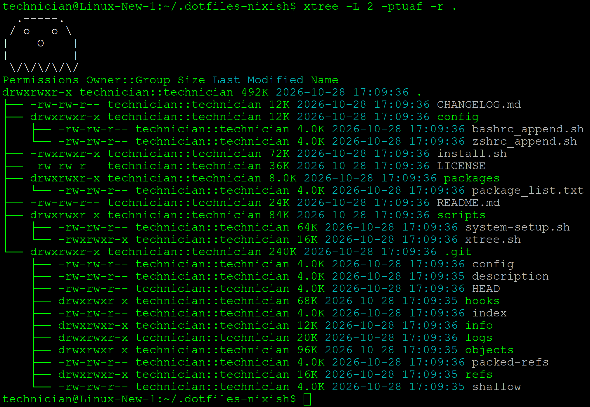

# xtree

A Bash script for \*nix that combines the functions of `tree`, `ls -l`, `du`, and `getfacl`. It shows a colourised directory tree with per-entry sizes and can also show permissions, owner/group, modification times and ACLs. It can export the result to CSV.



---

## Table of Contents

- [Requirements](#requirements)
- [Install](#install)
- [Usage](#usage)
- [Relationship to dotfiles-nixish](#relationship-to-dotfiles-nixish)
- [License](#license)

---

## Requirements

- `bash`, plus the standard coreutils: `ls`, `du`, `stat`, `awk`, `sed`, `cut`, `tr`. It uses `stat -c`, which is GNU stat syntax.
- `getfacl` (from the `acl` package). You only need it for `-A`.
- `tput` is optional. If it's missing, the script falls back to raw ANSI colour codes.

## Install

```sh
curl -fsSL https://raw.githubusercontent.com/entropytwo-ai/xtree/main/xtree.sh -o ~/.local/bin/xtree
chmod +x ~/.local/bin/xtree
```

## Usage

```
xtree [options] /path/to/directory
```

| Flag | Description |
|------|-------------|
| `-f` | Include files (by default only directories are listed) |
| `-L depth` | Maximum traversal depth (default `3`) |
| `-p` | Show permissions |
| `-t` | Show last-modified date/time |
| `-u` | Show `owner::group` |
| `-a` | Include hidden files and directories |
| `-C file` | Write the output to a CSV file instead of the terminal |
| `-s scheme` | Colour scheme: `default`, `alternative`, `christmas`, `halloween`, `ghost` |
| `-r` | Pick a random colour scheme |
| `-A` | Show ACL entries for paths that have them (a `+` in the permissions; use with `-p`) |

Examples:

```sh
xtree -L 2 /var                 # directory sizes, two levels deep
xtree -fpu -L 1 ~               # files too, with permissions and owner::group
xtree -fptuA -C report.csv /srv # full detail exported to CSV
```

To turn colours off, set `NO_COLOR=1` or `TERM=dumb`.

## Relationship to dotfiles-nixish

This repo is the main place where xtree is developed. A copy lives in [`dotfiles-nixish`](https://github.com/entropytwo-ai/dotfiles-nixish) at `scripts/xtree.sh`, where `nix/xtree.nix` packages it. **That copy is kept in sync automatically.** Each push to `main` here that changes `xtree.sh` runs [`.github/workflows/sync-to-dotfiles.yml`](.github/workflows/sync-to-dotfiles.yml), which commits the new version straight to dotfiles-nixish's `main`. Make changes here, not in dotfiles-nixish, because the sync will overwrite edits made there.

The workflow needs a repository secret named `DOTFILES_SYNC_TOKEN`. It must be a fine-grained personal access token with **Contents: Read and write** on `entropytwo-ai/dotfiles-nixish`. You can also run the sync by hand from the Actions tab (*Run workflow*).

## License

GPL-3.0. See [LICENSE](LICENSE).
