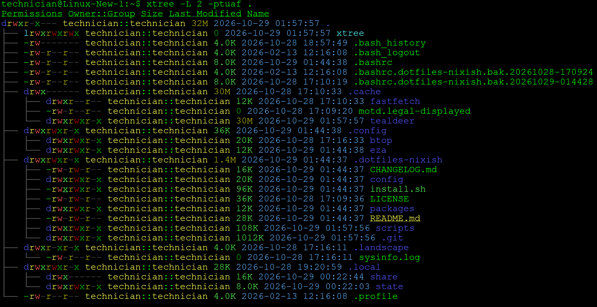

# xtree

A Bash script for \*nix that combines the functions of `tree`, `ls -l`, `du`, and `getfacl`. It shows a colourised directory tree with per-entry sizes and can also show permissions, owner/group, modification times and ACLs. It can export the result to CSV.



---

## Table of Contents

- [Requirements](#requirements)
- [Install](#install)
- [Usage](#usage)
- [Relationship to dotfiles-nixish](#relationship-to-dotfiles-nixish)
- [License](#license)

---

## Requirements

- `bash` 4.4 or newer, GNU `find` (findutils) and GNU coreutils (`du`, `ls`, `sort`, `xargs`). It reads the whole tree with one `find` and one `du` pass, so it stays fast on large folders.
- `git` is optional. You only need it for `-G`.
- `getfacl` (from the `acl` package). You only need it for `-A`.
- `tput` is optional. If it's missing, the script falls back to raw ANSI colour codes.

<sub>[↑ Back to contents](#table-of-contents)</sub>

## Install

```sh
curl -fsSL https://raw.githubusercontent.com/entropytwo-ai/xtree/main/xtree.sh -o ~/.local/bin/xtree
chmod +x ~/.local/bin/xtree
```

<sub>[↑ Back to contents](#table-of-contents)</sub>

## Usage

```
xtree [options] /path/to/directory
```

| Flag | Description |
|------|-------------|
| `-f` | Include files (by default only directories are listed) |
| `-L depth` | Maximum traversal depth (default `3`) |
| `-p` | Show permissions |
| `-t` | Show last-modified date/time |
| `-u` | Show the owner (user) column |
| `-g` | Show the group column |
| `-a` | Include hidden files and directories |
| `-C file` | Write the output to a CSV file instead of the terminal |
| `-s scheme` | Colour scheme: `default` (eza-style), `alternative`, `christmas`, `halloween`, `ghost` |
| `-r` | Pick a random colour scheme |
| `-A` | Show ACL entries for paths that have them (a `+` in the permissions) |
| `-o key` | Sort by `name` (default), `size` (largest first), `time` (newest first), `type` (by extension) or `none` |
| `-O` | Reverse the sort order |
| `-D` | List directories before files |
| `-H` | Size heat map: colours sizes by their share of the parent folder and adds a `%` column with a bar |
| `-G` | Git status next to each entry (`M`, `A`, `??`, …; `*` = folder contains changes). Only shown inside a git repo |
| `--color=WHEN` | `auto` (default: colours only on a terminal, plain text when piped), `always` or `never` |

Examples:

```sh
xtree -L 2 /var                 # directory sizes, two levels deep
xtree -fpug -L 1 ~              # files too, with permissions, owner and group
xtree -fptugA -C report.csv /srv # full detail exported to CSV
xtree -fDH -o size -L 1 /var    # what is using the space, biggest first
xtree -fG -L 2 .                # which files in this repo have changed
xtree -f --color=always . | less -R   # keep colours when paging
```

Each run ends with a summary such as `4 directories, 12 files, 1.0M total`.

The `default` scheme copies [eza](https://github.com/eza-community/eza)'s default colours: file kinds, file types by name and extension (images, video, music, archives, documents, source and more), per-character permissions, sizes coloured by magnitude, owner/group, git status and dim tree lines. The one deliberate change is the timestamp: it uses the lighter blue `38;5;75` (#5fafff) so it is easier to read. Like eza, it honours `LS_COLORS` and `EZA_COLORS` (for example `EZA_COLORS="da=31:*.txt=35"`; use `reset` to drop the built-in colours).

Colours turn off automatically when the output isn't a terminal. You can also turn them off with `NO_COLOR=1`, `TERM=dumb` or `--color=never`.

Symlinks to folders are listed, but xtree doesn't descend into them, so a link loop can't make it run forever.

<sub>[↑ Back to contents](#table-of-contents)</sub>

## Relationship to dotfiles-nixish

This repo is the main place where xtree is developed. A copy lives in [`dotfiles-nixish`](https://github.com/entropytwo-ai/dotfiles-nixish) at `scripts/xtree.sh`, where `nix/xtree.nix` packages it. **That copy is kept in sync automatically.** Each push to `main` here that changes `xtree.sh` runs [`.github/workflows/sync-to-dotfiles.yml`](.github/workflows/sync-to-dotfiles.yml), which commits the new version straight to dotfiles-nixish's `main`. Make changes here, not in dotfiles-nixish, because the sync will overwrite edits made there.

The workflow needs a repository secret named `DOTFILES_SYNC_TOKEN`. It must be a fine-grained personal access token with **Contents: Read and write** on `entropytwo-ai/dotfiles-nixish`. You can also run the sync by hand from the Actions tab (*Run workflow*).

<sub>[↑ Back to contents](#table-of-contents)</sub>

## License

GPL-3.0. See [LICENSE](LICENSE).

<sub>[↑ Back to contents](#table-of-contents)</sub>
